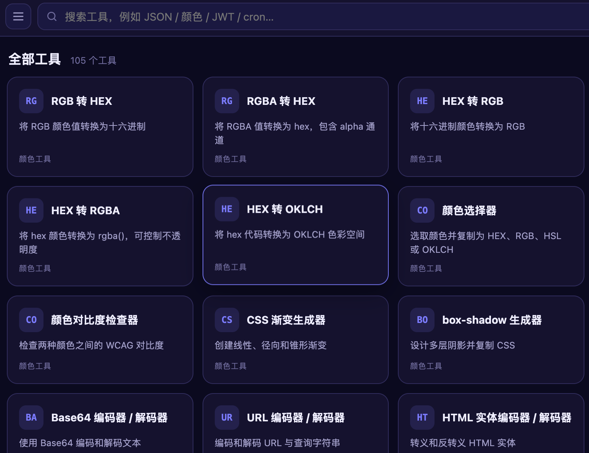
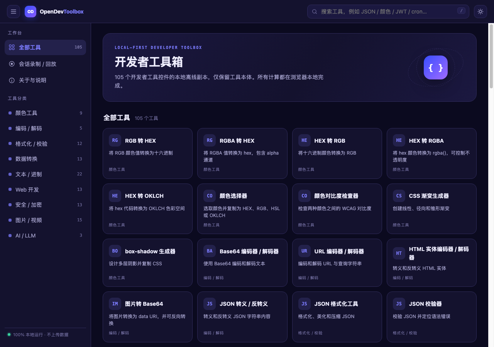
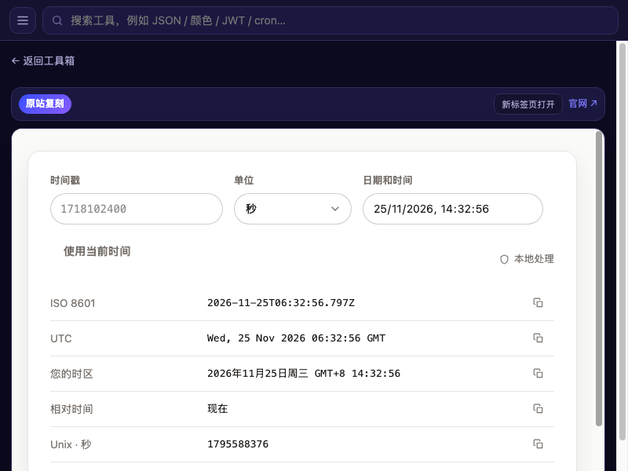
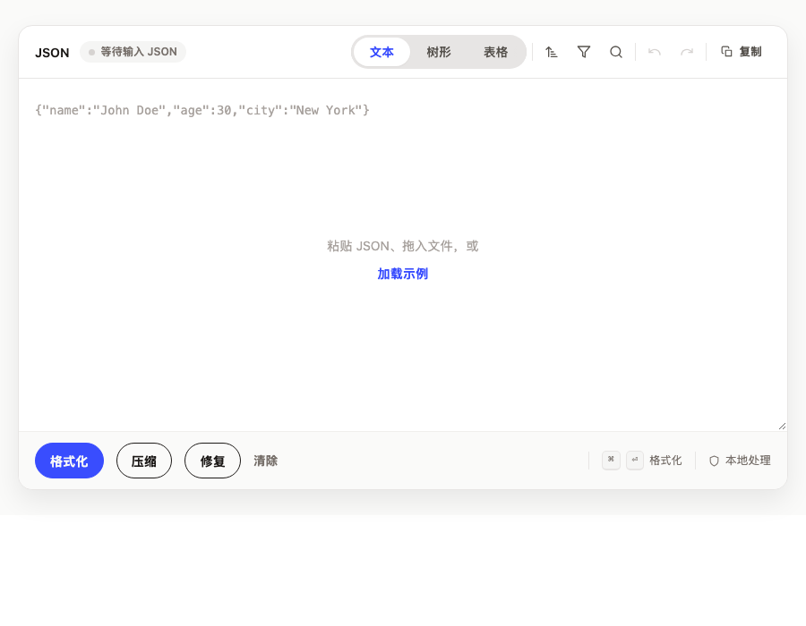

# OpenDevToolbox — 开发者工具箱 Chrome 插件

一个本地优先的 Chrome Manifest V3 扩展。点击工具栏图标即可在弹窗中打开工具箱，内置 106 个开发者工具，并附带轻量级的会话录制 / 回放。

绝大多数工具页面都已本地化，离线可用，不上传任何数据；IP 地址查询会向公共查询服务发送所查询的 IP。

## 安装

1. 打开 Chrome，地址栏输入 `chrome://extensions`
2. 打开右上角「开发者模式」
3. 点击「加载已解压的扩展程序」，选择本扩展目录
4. 点击工具栏图标，工具箱直接显示在弹出的窗口中（800×600，Chrome 弹窗上限）；点工具后会在同一个弹窗内展示工具本体

也可以直接打开 `app.html` 以普通网页形式预览工具箱（录制 / 回放功能需要扩展环境）。

## 使用

- **工具箱**：顶部搜索框支持中英文关键词（按 `/` 快速聚焦），左侧按 9 个分类筛选。
- **工具**：点击工具卡片，弹窗内直接显示对应工具控件；工具区另有「新标签页打开」按钮，需要更大画面时可点它。
- **会话录制 / 回放**：侧栏底部「会话录制 / 回放」→ 开始录制当前标签页 → 在页面上操作 → 停止并保存。回放视图提供 DOM 快照时间轴、控制台 / 网络 / 错误 / 交互标签页；会话可导出 / 导入 JSON。
- **主题**：右上角按钮切换深色 / 浅色，偏好保存在本地。

## 界面预览

**工具箱弹窗（搜索与工具卡片）**



**完整界面（含分类侧栏）**



**在弹窗内打开工具**



**独立工具页面**



## 工程结构

```
manifest.json              # MV3 扩展配置
popup.html                 # 弹窗外壳（800×600 iframe 容器）
app.html / app.css         # 工具箱界面
js/app.js                  # 主界面逻辑
js/catalog.js              # 工具目录
js/utils.js                # 通用工具函数
js/recorder-ui.js          # 会话录制 / 回放界面
background.js / content.js # 后台状态与页面录制脚本
scripts/build_replica.py   # 生成工具控件本地副本（本地化资源、裁剪页面）
replica/pages/*.html       # 106 个工具控件页面
replica/pages/*.inline-*.js# 工具页面内联脚本
replica/assets/            # JS / CSS 资源
replica/root/              # 图片、图标等静态资源
icons/                     # 扩展图标
```

需要重新生成工具页面时运行：

```
python3 scripts/build_replica.py
```

## 工具覆盖（106 个）

| 分类 | 数量 | 示例 |
| --- | ---: | --- |
| 颜色工具 | 9 | RGB/HEX/OKLCH 转换、颜色选择器、WCAG 对比度、渐变、box-shadow |
| 编码 / 解码 | 5 | Base64、URL、HTML 实体、图片 data URI、JSON 转义 |
| 格式化 / 校验 | 12 | JSON/XML/SQL/HTML/CSS/JS 格式化与压缩、JSONL 校验 |
| 数据转换 | 13 | JSON⇄CSV/YAML/XML/TOML、JSON→TS/Go/Schema、curl、Markdown |
| 文本 / 进制 | 22 | diff、字数、正则、时间戳、cron、进制互转、ASCII、chmod |
| Web 开发 | 14 | HAR 查看器、UA/URL/Cookie 解析、IP 地址查询、meta 标签、ICE/泄露测试、gitignore |
| 安全 / 加密 | 13 | JWT 编解码、MD5/SHA、HMAC、AES、UUID/密码、子网、QR Code |
| 图片 / 视频 | 15 | 图片转换 / 压缩、favicon、SVG→PNG、视频截取与帧导出 |
| AI / LLM | 3 | Token 估算、成本计算、上下文窗口检查 |

## 已知限制

- Chrome 扩展 MV3 的 CSP 禁止 `eval` / `new Function`。少数依赖它的工具（`jsonpath-tester`、`heic-to-jpg`、`jpg-to-png`、`png-to-jpg`、`webp-to-png`、`svg-to-png`、`image-compressor`）在扩展页内可能无法正常执行核心逻辑；点「新标签页打开」后作为普通网页打开不受此限制。
- 会话录制只保存在本机，不上传。
- IP 地址查询需要联网：留空查询当前出口 IP 或输入指定 IP 时，会向 `ipwho.is` 发送该 IP 以获取归属信息。
